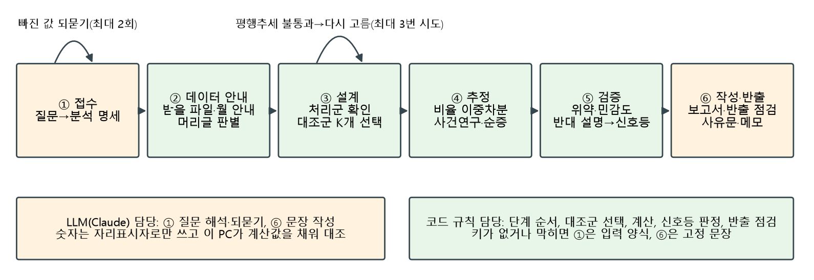
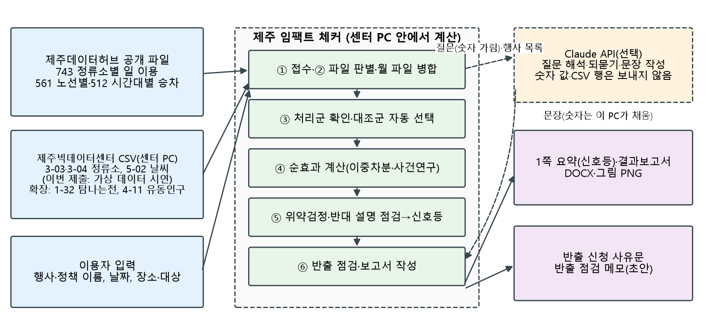
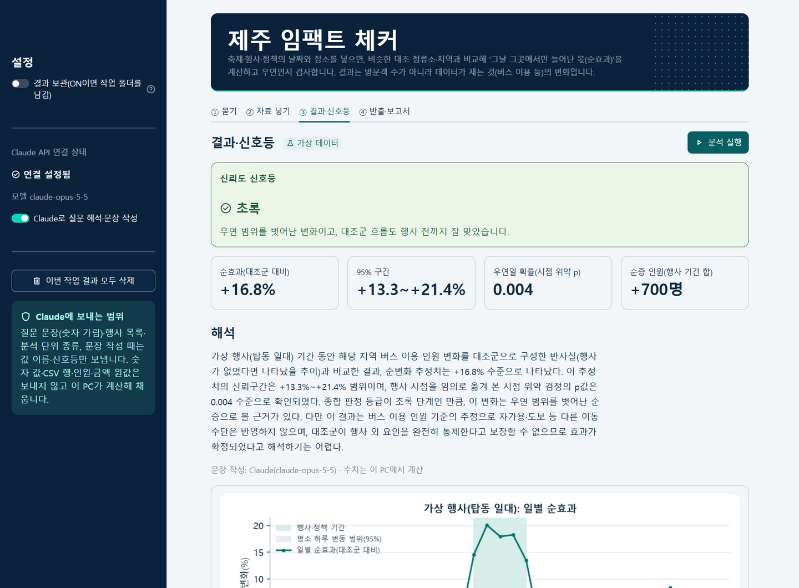
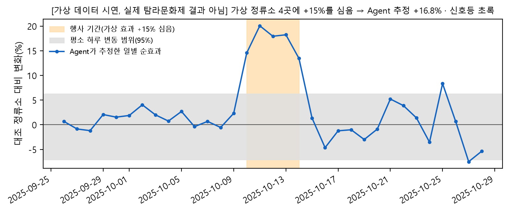
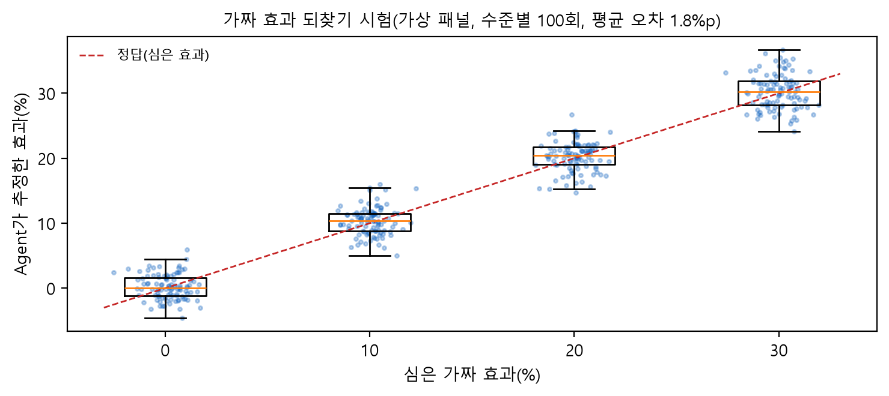

# 결과 설명자료: 제주 임팩트 체커

축제·행사·정책의 날짜와 장소(또는 대상)를 넣으면, 비슷한 흐름의 대조 정류소·대조 이용자 유형과 비교해 버스 이용 순증분을 계산하고 우연인지 검사하는 AI Agent입니다.
**결과는 방문객 수를 대신하지 않습니다.** 주최 측 추산과 정책 성과를 대중교통 이용 순증분으로 교차 점검합니다.

## 1. 문제 정의
- 축제·정책의 성과를 근거로 증명할 수단이 부족합니다. 방문객 총량 추산은 "행사가 없었어도 왔을 사람"을 빼지 못하고, 단순 전년 대비는 날씨·요일·추세 변화가 섞입니다.
- 제주 지정축제 평가는 예산과 연결되어 있어, 근거 있는 순효과 자료가 필요합니다.
- 제주빅데이터센터는 정류소·읍면동 단위 일 자료를 갖고 있지만, 비전문가가 대조군을 고르고 통계 검정을 하며 반출 기준까지 맞추기는 어렵습니다.

## 2. Agent 구조

| 역할 | 하는 일 | 코드 | Claude 사용 |
|---|---|---|---|
| ① 접수 | 질문 → 분석 명세(행사·기간·장소·단위), 빠진 값 되묻기(최대 2회) | llm.parse_question, app.py | 예(질문 문장·행사 목록·단위 종류만, 세 자리 이상 숫자 가림) |
| ② 데이터 안내 | 파일 종류 판별(허브 3종·센터 명세서 v13의 71개 표), 받을 월 목록·운영자 요청문 | loaders.py, pipeline.download_guide | 아니오 |
| ③ 설계 | 처리군 확인(이름 대응표·도로 통제 표시), 대조군 자동 선택·재선택(최대 3번 시도) | pipeline.match_units, effect.py | 아니오 |
| ④ 추정 | 비율 이중차분(요일 보정), 긴 기간 삼중차분, 사건연구, 순증 인원 | effect.estimate | 아니오 |
| ⑤ 검증 | 시점·지역 위약검정, 민감도, 반대 설명 점검 7종 → 신호등 | effect.py, checks.py | 아니오 |
| ⑥ 작성·반출 | 1쪽 요약·보고서(DOCX·PNG), 반출 점검, 사유문·점검 메모 | report.py, export_guard.py, llm.write_narrative | 예(값 이름·신호등만, 숫자는 이 PC가 채움) |

- 계산·판정을 LLM에 맡기지 않은 이유: 같은 입력이면 같은 결과(재현성), 원값 외부 전송 금지, 키가 없어도 동작.
- 데이터 흐름: 

## 3. 주요 기능 (화면 4단계)

화면별 캡처와 설명은 README 5장에 있습니다. 각 단계 끝의 **다음** 버튼으로 ①→④를 차례로 넘어갑니다.

1. **묻기**: 내장 행사·정책 9건 선택 또는 질문 입력 → 분석 명세 확인·수정.
2. **자료 넣기**: 허브 공개 파일 / 센터 CSV 업로드 / 가상 데이터. 허브 파일은 필요한 파일(743·561·512)·보유 여부·받는 곳 링크 표, 화면에서 바로 올리기, 공개 표본 행 미리보기를 제공. 처리군 후보 표에서 확인·도로 통제 표시.
3. **결과·신호등**: 순효과·95% 구간·우연일 확률·순증 인원(원본 반출 가능 자료만), 그림 3개, 반대 설명 점검, 판단 기록.
4. **반출·보고서**: DOCX·PNG·반출 신청 사유문·점검 메모, 작업 결과 삭제.

## 4. 실행 결과 (가상 데이터 시연)
참가자가 허브 버스 파일을 받지 못해, 공개 명세서 v13 컬럼 구조 그대로 만든 **가상 센터 데이터**(`impact_engine/synth.py`, 값은 지어낸 것)로 시연했습니다.
재현: `.venv\Scripts\python analysis\demo_synth.py`

| 사례 | 설정 | 결과 | 신호등 |
|---|---|---|---|
| A | 탑동 일대 가상 정류소 4곳, 2025-10-10~14에 +15% 심음 | +16.8% (95% 구간 +13.3~+21.4%), p=0.004 | 초록 |
| B | 같은 정류소, 효과 안 심은 2025-06-10~14 | −2.3% (−5.5~+1.0%), p=0.361 | 빨강(우연과 구별 안 됨) |
| C | 가상 탐나는전(반출 불가) 건입동·일도1동 +15% | +9.3% (+0.5~+20.2%), p=0.088, 원값·대조 이름 미표시 | 노랑(판단 유보) |

- 분석 1건 소요(가상 데이터, 정류소 40곳): 대조군 선택·추정·위약검정 약 1초. Claude를 켜면 질문 해석부터 문장·보고서까지 약 18~19초(3회 실측, 사람이 입력·확인하는 시간 제외, `analysis/e2e_timing_20261119.json`, 재측정 `analysis/measure_e2e.py`).
- Claude 실호출 확인(2026-11-19, 모델별 3회): Haiku·Sonnet·Opus 5.5 모두 질문 해석·되묻기·문장 작성 동작. 1회 분석 비용(질문 1회, 실측 평균 토큰 × 공식 요금) Haiku 약 0.0013달러, Sonnet 약 0.012달러, Opus 약 0.039달러.

## 5. 검증 방법·한계
### 가짜 효과 되찾기 시험 (가상 패널)
재현: `.venv\Scripts\python analysis\recovery_synth.py`

| 지표 | 목표 | 결과(400회) |
|---|---|---|
| 평균 절대 오차 | 3%p 이하 | 1.8%p |
| 95% 구간 포함률 | 90% 이상 | 94% |
| 효과 없을 때 거짓 양성률(p<0.05) | 10% 이하 | 3% |
| 20% 효과 검출률(p<0.05·증가) | 80% 이상 | 100% |

- 단위 시험: `.venv\Scripts\python -m pytest -q` (18개: 효과 되찾기, 반출 판정, 10 미만 블라인드·2차 가림, 숫자 가림, Claude 전송 범위, 화면 흐름·'다음' 버튼 이동·허브 화면, 허브 공개 표본 행 판별·읽기).

### 허브 실제 자료 재현 (결과 미수록)
- `data/hub/`에 743·561·512 파일을 넣고 `analysis/recovery_test.py`(실제 정류소 되찾기 시험), `analysis/case_tamna.py`(탐라문화제 2024·2025), `analysis/case_youth.py`(2025-08 청소년 버스 무료화, 561 청소년 대 일반 삼중차분 + 512 교차 점검)를 실행하면 같은 방법으로 결과가 나옵니다. 이번 제출 시점에는 파일을 받지 못해 결과를 싣지 않았습니다. 파일 형식은 허브 상세 화면에 공개된 표본 행으로 판별·읽기 시험을 했고(tests/test_hub_format.py), 전체 파일로는 실행하지 않았습니다.

### 한계
- 버스 이용 순증분은 방문객 수가 아닙니다(자가용·도보·관광버스 미포함).
- 도로 통제·임시 정류소·셔틀은 정류소 이용을 기계적으로 바꿉니다 → 표시한 정류소를 뺀 결과와 넣은 결과를 함께 냅니다.
- 가상 데이터는 실제 자료보다 잡음·결측이 적을 수 있어, 실제 정확도는 허브 자료 시험으로 확인해야 합니다.
- 허브 버스 파일은 2025-10 하순까지라 그 뒤 행사는 센터 자료가 필요합니다.
- 평행추세 가정이 깨지면 효과가 틀릴 수 있어, 직전 가짜 행사 검정과 재선택으로 점검하고 실패하면 경고합니다.
- 날씨 자료를 넣지 않으면 강수·강풍 점검을 하지 않습니다.

## 6. 센터 활용 방안
- 센터 방문 이용자(기관·기업)가 축제 결과보고서·지정축제 평가 자료의 '순효과' 절, 교통대책·요금정책 평가를 직접 만듭니다.
- 센터 컨설팅·분석 지원을 셀프서비스로 넓히고, 반출 신청 사유문·점검 메모 초안으로 반출 심사 준비를 돕습니다.
- 탑재: 센터 담당자가 `install.bat` → `.env`에 운영 키 → `run.bat`. 결과 보관 OFF(기본)로 퇴실 후 자료 삭제 원칙을 지킵니다.
- 확장: 센터 1-32 탐나는전·4-11 유동인구 실자료 분석, 좌표 반경 처리군(3-03·허브 612), 허브 Open API 자동 수집, VISIT JEJU 행사 자동완성.
